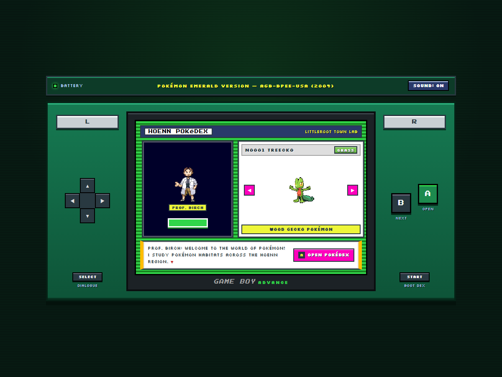
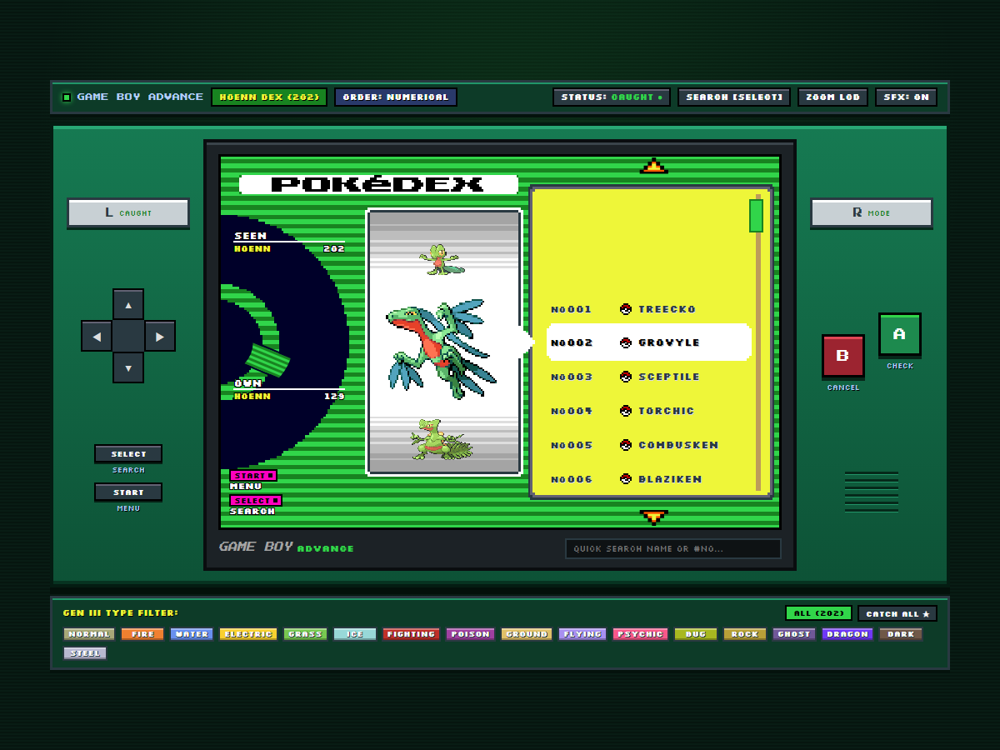
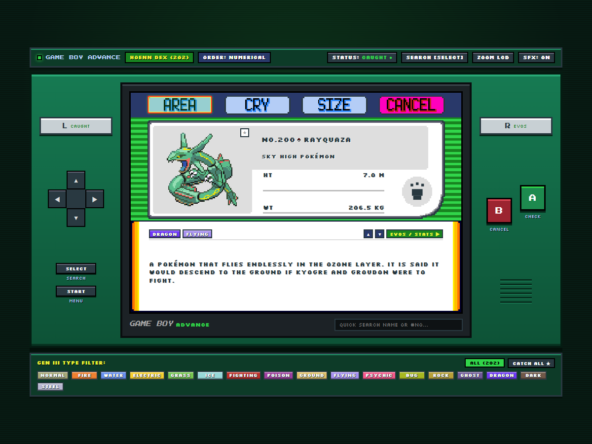
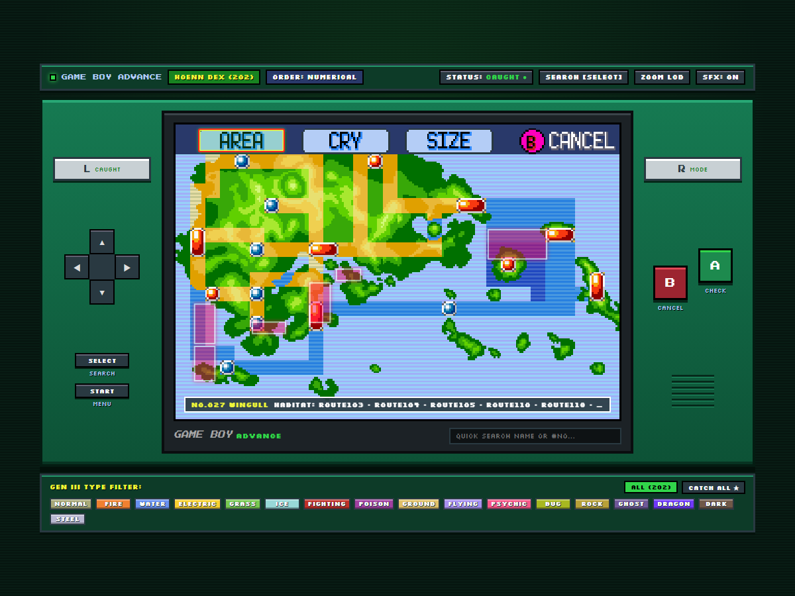
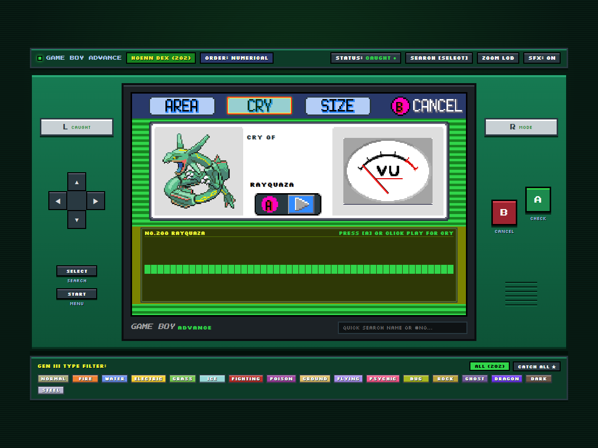
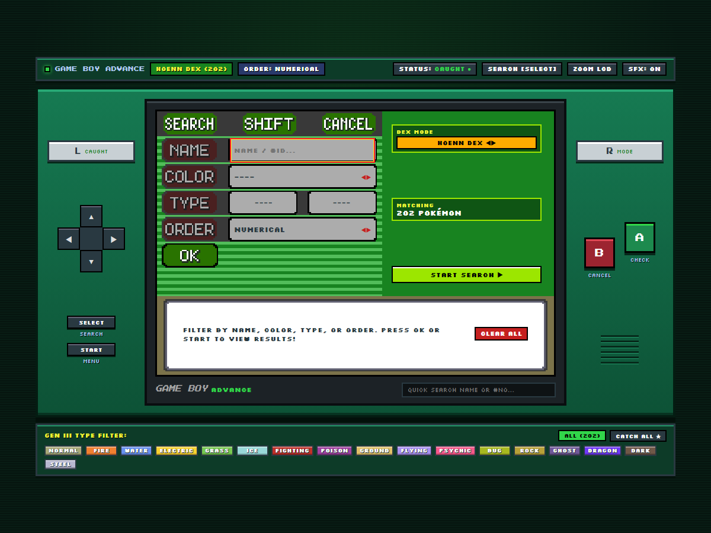

<div align="center">

# 🎮 Pokédex Pokémon Esmeralda — Recreación Game Boy Advance (2004)

<p align="center">
  
  
  
  
  
  
</p>

<p align="center">
  
  
  
  
  
</p>

**¡Hola! 👋 Bienvenido a mi proyecto de portfolio frontend.**  
Este repositorio es una recreación interactiva en **Angular 18** de la **Pokédex de Pokémon Esmeralda (*Game Boy Advance, 2004*)**, cuidando las proporciones originales (`240 × 160` píxeles), los sprites de 3.ª generación, los sonidos retro y los controles tanto en pantalla como con teclado.

</div>

---

## 📸 Vista Previa del Proyecto

| Laboratorio del Prof. Abedul (Intro) | Lista Pokédex — Modo Hoenn (202) |
| :---: | :---: |
|  |  |

| Ficha Individual (`INFO`) | Mapa de Hábitats de Hoenn (`AREA`) |
| :---: | :---: |
|  |  |

| Osciloscopio y Medidor VU (`CRY`) | Comparador de Tamaño (`SIZE`) y Búsqueda (`SEARCH`) |
| :---: | :---: |
|  |  |

---

## 🧠 ¿Cómo nació y cómo armé este proyecto? (De una web básica a una GBA real)

Cuando empecé este proyecto para practicar **Angular**, tenía la típica Pokédex hecha con **Bootstrap**, tarjetas modernas con bordes redondeados y llamadas básicas a la **PokéAPI**. Funcionaba para listar nombres, pero tenía varios problemas que me hicieron querer darle una vuelta completa:

1. **El filtro de tipos no funcionaba bien**: Al principio intentaba filtrar una lista de más de 1.000 Pokémon sin haber descargado antes los tipos de cada uno, así que el buscador por tipo se quedaba vacío hasta que entrabas uno por uno.
2. **Se veía como cualquier dashboard genérico**: Quería que mi proyecto de portfolio destacara visualmente y que cualquier persona que hubiera jugado **Pokémon Esmeralda** en la Game Boy Advance sintiera nostalgia al instante.

Así que antes de tocar nada hice un *commit* y una etiqueta de respaldo (`restore-point-pre-emerald`) por seguridad, ¡y me puse manos a la obra para transformarlo paso a paso!

---

## 🛠️ Paso a paso: Cómo lo fui construyendo

### 1. Entendiendo la rejilla `240 × 160` de la Game Boy Advance 🖼️
En vez de usar contenedores flexibles normales con márgenes aleatorios, aprendí que la pantalla original de la GBA tiene una resolución exacta de **`240 × 160` píxeles** (relación de aspecto `3:2`).
- Configuré el visor principal (`.gba-lcd-viewport`) con `aspect-ratio: 3 / 2` y posicioné las capas usando porcentajes calculados sobre esa rejilla de `240 × 160`.
- En el CSS global (`src/styles.css`) activé `image-rendering: pixelated` y desactivé el suavizado de fuentes para que los sprites de 3.ª generación y las letras pixeladas (`Press Start 2P` y `Silkscreen`) no se vieran borrosos al escalar la pantalla.

### 2. Estructurando los datos de 3.ª Generación (Hoenn y Nacional) 📊
Para solucionar el problema que tenía al principio con los filtros y no depender de hacer 386 peticiones seguidas a la API al abrir la web:
- Armé un archivo de datos estructurado (`src/app/data/emerald-pokedex.data.ts`) con las **386 especies de la 3.ª Generación** (`#001 Bulbasaur` hasta `#386 Deoxys`) y el mapeo exacto de los **202 Pokémon de la región de Hoenn** (`#001 Treecko` hasta `#202 Deoxys`).
- Incluí los tipos clásicos de 3.ª generación (¡antes de que existiera el tipo Hada!), sus categorías, descripciones oficiales de Esmeralda, cadenas evolutivas, alturas, pesos, escalas de tamaño y las rutas de Hoenn donde aparecen.
- Además, en `src/app/pokemon.service.ts` conecté **PokéAPI** con caché en memoria para enriquecer estadísticas base en vivo y guardé el estado de **Pokémon Vistos y Capturados** en `localStorage` (`emerald_pokedex_save_v1`) para que tus capturas no se borren al recargar la página.

### 3. Creando las 6 pantallas como una máquina de estados 🕹️
En lugar de recargar toda la página cada vez que cambias de vista, organicé `DashboardComponent` (`src/app/components/dashboard/`) como una pequeña máquina de estados igual que en un videojuego:
- **`LIST` (Lista principal)**: Tiene la lista amarilla a la derecha con 9 filas visibles, la rueda de la Poké Ball que gira a la izquierda al hacer scroll y el tambor cilíndrico central donde se ven **3 sprites a la vez** (el Pokémon anterior arriba y el siguiente abajo ligeramente achatados con `scaleY` para dar el efecto 3D del rodillo de Esmeralda).
- **`INFO` (Ficha del Pokémon)**: Muestra el sprite (con un botón `★` para verlo en versión **Shiny**), su número, la Poké Ball de capturado (`public/assets/emerald/caught_ball.png`), altura/peso, huella, tipos, descripción y una segunda pestaña con su **cadena evolutiva clicable** y estadísticas.
- **`AREA` (Mapa de Hoenn)**: Usa el mapa pixel-art de Hoenn (`public/assets/emerald/bg_area_screen.png`) e ilumina con cuadros rojos parpadeantes las rutas o cuevas donde vive ese Pokémon (o muestra `AREA UNKNOWN` si solo se consigue por evolución o evento).
- **`CRY` (Grito y Osciloscopio)**: Reproduce el grito clásico del Pokémon mientras se mueve la aguja del medidor **VU** (`public/assets/emerald/cry_meter.png`) y las barras verdes del osciloscopio.
- **`SIZE` (Comparación de Tamaño)**: Compara la silueta en negro del Pokémon contra la silueta del entrenador **Brendan** (`public/assets/emerald/brendan_silhouette.png`) respetando su escala real.
- **`SEARCH` y `START MENU`**: Permite filtrar combinando nombre, color, Tipo 1, Tipo 2, orden (`NUMERICAL`, `A TO Z`, `HEAVIEST`, `LIGHTEST`, `TALLEST`, `SMALLEST`) y cambiar entre la **Hoenn Dex (202)** y la **National Dex (386)**.

### 4. Sonidos retro sin archivos pesados usando Web Audio API 🔊
Una de las cosas que más me gustó aprender haciéndolo fue crear `src/app/services/gba-audio.service.ts`.  
Usando la **Web Audio API** del navegador, programé osciladores de onda cuadrada y triangular para recrear los pitidos clásicos del menú de la GBA (el clic al bajar en la lista, al abrir una página o al cancelar), además de reproducir los gritos originales en formato `.ogg` y calcular la amplitud en tiempo real para mover el osciloscopio de la pantalla `CRY`.

---

## ⌨️ Controles (Botones en Pantalla y Teclado)

Puedes usar la Pokédex haciendo clic en la consola Game Boy Advance de la pantalla (también adaptada a móvil) o directamente con el teclado:

| Botón GBA | Teclado | Función dentro de la Pokédex |
| :---: | :---: | :--- |
| **Cruceta `▲` / `▼`** | `Flecha Arriba/Abajo` o `W` / `S` | Subir o bajar 1 Pokémon en la lista / Moverse por menús |
| **Cruceta `◀` / `▶`** | `Flecha Izq./Der.` o `A` / `D` | Saltar páginas de 7 en 7 en la lista / Cambiar entre `AREA`, `CRY`, `SIZE`, `CANCEL` |
| **Botón `A`** | `Enter` o `Z` | Abrir ficha del Pokémon / Confirmar opción / Escuchar grito en `CRY` |
| **Botón `B`** | `Escape`, `Backspace` o `X` | Volver a la pantalla anterior / Cerrar menú |
| **Botón `START`** | `Shift` o `M` | Abrir el cajón inferior (`POKéDEX MENU`) |
| **Botón `SELECT`** | `Tab` o `F` | Abrir la pantalla de búsqueda avanzada (`SEARCH`) |
| **Gatillo `L`** | `L` | Marcar/desmarcar el Pokémon actual como **Capturado / Visto** |
| **Gatillo `R`** | `R` | Cambiar entre **Hoenn Dex (202)** y **National Dex (386)** (o ver Evoluciones en `INFO`) |

---

## 📂 Estructura Principal del Proyecto

```text
pokedex/
├── public/assets/
│   ├── emerald/              # Tilemaps 240x160 y sprites de interfaz de Pokémon Esmeralda
│   └── screenshots/          # Capturas de todas las pantallas del proyecto
├── src/app/
│   ├── components/
│   │   ├── main/             # Pantalla de bienvenida en el Laboratorio del Prof. Abedul
│   │   └── dashboard/        # Consola GBA y las 6 pantallas de la Pokédex
│   ├── data/
│   │   └── emerald-pokedex.data.ts # Datos completos Gen III (386 Nacional / 202 Hoenn)
│   ├── models/
│   │   └── pokemon.models.ts # Interfaces TypeScript del proyecto
│   ├── services/
│   │   └── gba-audio.service.ts    # Sintetizador de efectos GBA y reproductor de gritos
│   └── pokemon.service.ts    # Lógica de filtrado, ordenación, PokéAPI y localStorage
└── src/styles.css            # Sistema de diseño GBA, fuentes pixeladas y badges de tipos Gen III
```

---

## 🚀 Cómo ejecutar el proyecto en tu ordenador

1. **Clonar el repositorio:**
   ```bash
   git clone https://github.com/andradegali1503-droid/pokex-gamboy.git
   cd pokex-gamboy
   ```

2. **Instalar las dependencias:**
   ```bash
   npm install
   ```

3. **Iniciar el servidor de desarrollo:**
   ```bash
   npm start
   ```
   Luego abre tu navegador en `http://localhost:4200/`.

4. **Compilar para producción (con soporte SSR):**
   ```bash
   npm run build
   ```

---

<div align="center">

<p>
  
</p>

Hecho con mucho cariño, código limpio y nostalgia de Hoenn 💚  
*Proyecto de práctica Frontend con Angular 18.*

</div>
